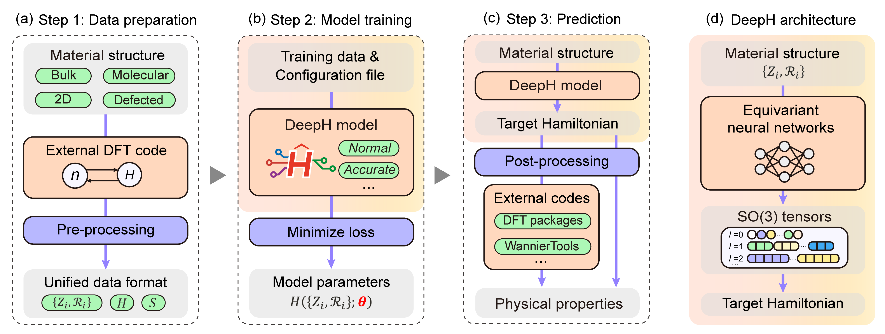

Core Workflows
^^^^^^^^^^^^^^
A naive illustration of the DeepH-pack workflow is demonstrated as follows:

`Source: npj Comput. Mater. 12, 361 (2026) <https://doi.org/10.1038/s41524-026-02219-2>`_

DeepH-pack enables the prediction of ab initio Hamiltonians using deep neural networks. The standard workflow consists of three sequential stages:

1. **DFT Data Interface Setup**: Prepare and format density functional theory (DFT) calculations for neural network training
2. **Model Training**: Configure, train, and validate deep learning models on electronic structure data
3. **Prediction & Interface**: Deploy trained models for Hamiltonian predictions and integrate with downstream calculations

Each workflow builds upon the previous stage, ensuring a consistent pipeline from DFT data to deep learning predictions. These guides are intended for both new users establishing their first workflow and experienced developers extending the framework.

.. toctree::
    :maxdepth: 2

    data_preparation
    model_training
    making_predictions
